<picture><source media="(prefers-color-scheme: dark)" srcset="assets/hero-dark.svg"></picture>

<picture><source media="(prefers-color-scheme: dark)" srcset="assets/about-dark.svg"></picture>

<picture><source media="(prefers-color-scheme: dark)" srcset="assets/stack-dark.svg"></picture>

<a href="https://github.com/AstraSuite/Atlas"><picture><source media="(prefers-color-scheme: dark)" srcset="assets/project-atlas-dark.svg"></picture></a>&nbsp;<a href="https://github.com/dim-ghub/midnight-shell"><picture><source media="(prefers-color-scheme: dark)" srcset="assets/project-midnight-shell-dark.svg"></picture></a>

<a href="https://github.com/AstraSuite/Airlock"><picture><source media="(prefers-color-scheme: dark)" srcset="assets/project-airlock-dark.svg"></picture></a>

<picture><source media="(prefers-color-scheme: dark)" srcset="assets/stats-dark.svg"></picture>

<picture><source media="(prefers-color-scheme: dark)" srcset="assets/streak-dark.svg"></picture>

<picture><source media="(prefers-color-scheme: dark)" srcset="assets/wave-dark.svg"></picture>

<a href="https://dim.contact"><picture><source media="(prefers-color-scheme: dark)" srcset="assets/button-1-dark.svg"></picture></a>&nbsp;&nbsp;<a href="https://github.com/dim-ghub?tab=repositories"><picture><source media="(prefers-color-scheme: dark)" srcset="assets/button-2-dark.svg"></picture></a>

<a href="https://metawka.github.io/expressive-profile/?from=dim-ghub"><picture><source media="(prefers-color-scheme: dark)" srcset="assets/credit-dark.svg"></picture></a>

